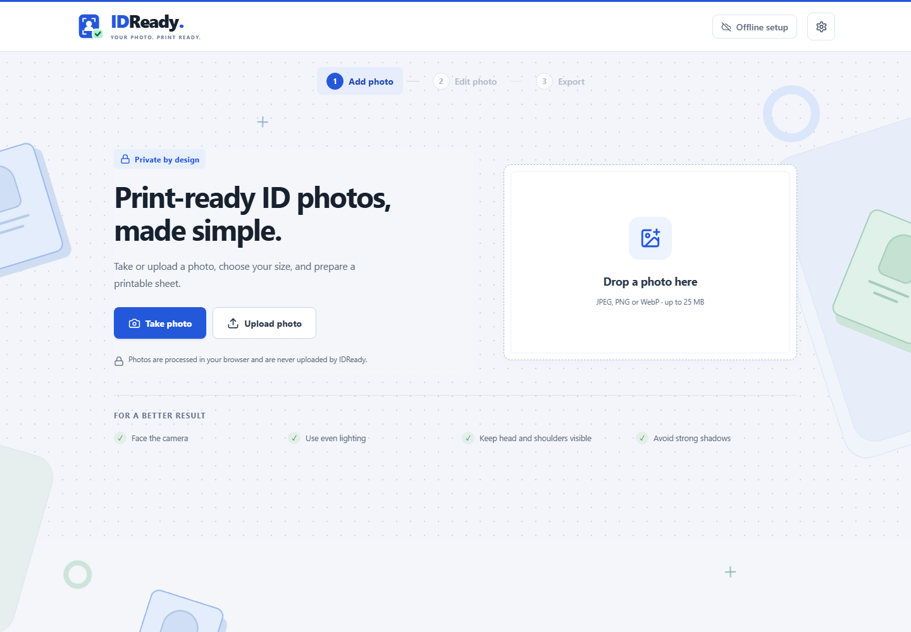
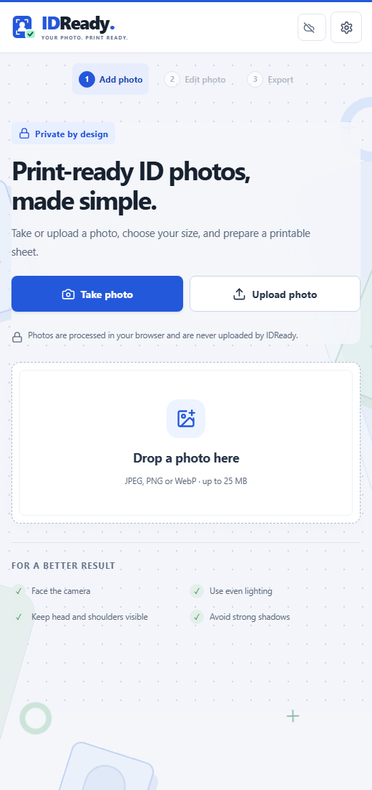

# IDReady

An offline-capable ID photo maker built with React, TypeScript, and Vite. Capture or upload a photo, edit it locally, and export individual images or printable PDF sheets.

Photo processing runs in the browser. No account, database, backend, or paid API is required.

## Contents

- [Preview](#preview)
- [Features](#features)
- [Getting started](#getting-started)
- [Development commands](#development-commands)
- [Architecture](#architecture)
- [Photo and paper sizes](#photo-and-paper-sizes)
- [Offline operation](#offline-operation)
- [Privacy and local storage](#privacy-and-local-storage)
- [Export and printing](#export-and-printing)
- [Deployment](#deployment)
- [Validation](#validation)
- [Known limitations](#known-limitations)
- [Troubleshooting](#troubleshooting)
- [Licensing](#licensing)

## Preview

Screenshots captured from the running application. Some controls have changed since these images were taken; animated backgrounds appear as still images.

### Desktop



### Mobile



## Features

- Camera capture with front/rear camera preference, countdown, retake, and upload fallback.
- JPEG, PNG, and WebP imports with file-signature validation.
- Local person segmentation with a white background and before/after review.
- Optional face detection to suggest an initial crop.
- Drag positioning, zoom, rotation, brightness, contrast, and reset controls.
- Selectable photo borders rendered inside the chosen photo dimensions.
- Optional digital name tag with a full name, second line, text-size presets, and alignment. A compact white label fits the text and overlays the bottom of the photo without changing its crop or position; long text shrinks to fit.
- Paper presets, orientation, margins, gaps, cutting guides, and multi-page PDF composition.
- Print-preview zoom and mouse/touch panning.
- PNG/JPEG downloads and PDF export with physical dimensions expressed in millimetres.
- One explicitly saved draft per browser, with confirmation before deletion.
- PWA app-shell caching and a separate download for offline AI assets.

### Workflow

1. **Add photo:** capture an image or upload a supported file.
2. **Edit photo:** select dimensions, optionally remove the background, and refine framing.
3. **Export:** select paper, copies, spacing, and borders, then download.

## Getting started

### Prerequisites

- Node.js 22.12+ is recommended. Vite also supports Node.js 20.19+.
- npm.
- A modern browser with Canvas, WebAssembly, IndexedDB, and Cache Storage support.

### Installation

```bash
git clone https://github.com/Ralphyy9yy/IDReady.git
cd IDReady
npm ci
npm run dev
```

Open the local URL printed by Vite. No environment variables are required.

The repository includes the model and WASM binaries under `public/`; keep these files when cloning or deploying.

### Production preview

```bash
npm run build
npm run preview
```

Use the production preview or an HTTPS deployment to test service-worker behavior. The development server does not enable the production PWA cache.

## Development commands

| Command | Purpose |
| --- | --- |
| `npm ci` | Install dependencies from the committed lockfile |
| `npm run dev` | Start the Vite development server |
| `npm run typecheck` | Check TypeScript project references |
| `npm run lint` | Run ESLint |
| `npm test` | Run the Vitest suite once |
| `npm run test:watch` | Run tests in watch mode |
| `npm run build` | Type-check and create the production build in `dist/` |
| `npm run preview` | Serve the production build locally |

## Architecture

| Layer | Responsibility |
| --- | --- |
| React + TypeScript | Workflow, camera lifecycle, editing controls, and export UI |
| Canvas + ImageBitmap | Image decoding, shared transformations, borders, and raster composition |
| MediaPipe Tasks Vision | CPU/WASM segmentation and face detection |
| jsPDF | Physical-size PDF pages and photo placements |
| IndexedDB via idb | Explicit local draft storage |
| vite-plugin-pwa + Workbox | App-shell precaching and AI runtime caching |

```text
src/
  App.tsx                      Workflow and current photo state
  components/layout/           Branding and decorative background
  features/
    capture/                   Camera dialog
    editor/                    Crop and adjustment controls
    export/                    Sheet preview and downloads
    offline/                   AI download and cache checks
  lib/
    geometry/                  Sheet layout and crop scale calculations
    units/                     Physical-unit conversions and paper presets
    validation/                Image file validation
  services/
    ai/                        MediaPipe initialization and inference
    image-processing/          Shared canvas rendering
    storage/                   IndexedDB draft operations
  styles/                      Base and feature-specific styles
  test/                        Unit and geometry tests
public/
  icons/                       Favicon and PWA icons
  models/                      Bundled TFLite models
  wasm/                        MediaPipe WASM binaries and loaders
```

Geometry and image-rendering functions are independent of React. Editor preview and export share the transformation pipeline. AI and PDF modules load dynamically; inference runs on demand rather than on every adjustment.

## Photo and paper sizes

Photo dimensions below are **width × height**.

| Photo preset | Dimensions |
| --- | --- |
| 1 × 1 inch | 25.4 × 25.4 mm |
| 2 × 2 inches | 50.8 × 50.8 mm |
| PH passport-size format / CSC | 35 × 45 mm |
| PRC online | 50.8 × 50.8 mm |
| 1½ × 1½ inches | 38.1 × 38.1 mm |
| 1 × 1½ inches | 25.4 × 38.1 mm |
| ASA landscape | 76.2 × 35.56 mm |

The ASA preset uses dimensions supplied for this project; it is not independently verified as an official requirement. To show two people in one photo, upload an image containing both people. Separate-photo pairing is not implemented.

Paper options are A4, A5, A6, Letter, Legal, 3R, 4R, 5R, 6R, and 8 × 10 inches. Both orientations are supported; exact values live in [papers.ts](src/lib/units/papers.ts).

Presets provide dimensions, not official acceptance guarantees. CSC requirements include a physical hand-held name tag and handwritten signature; the optional digital name tag does not replace them. DFA passport photos are captured during the appointment. Follow the receiving agency's current instructions.

## Offline operation

### First-time setup

1. Open the deployed HTTPS site while connected.
2. Allow the app shell to finish caching.
3. Open **Offline setup** and download the AI assets, approximately 51 MB uncompressed.
4. Wait for **Offline ready**.
5. Disconnect, reload normally, and test background removal and export.

Installation through the browser menu is optional and does not by itself verify that AI assets are available. Every user must complete setup in their own browser on their own device. A cached device does not need the developer's computer to remain on.

### Cache implementation

- Workbox precaches the application shell, including bundled JavaScript and styles.
- Models and WASM files are served through a `CacheFirst` route using `idready-ai-v1`.
- The explicit download writes the eight required model/runtime files into that cache.
- Readiness checks confirm required cache entries exist; they do not run inference or verify file hashes.
- Progress reports completed files, not transferred bytes.

Storage can be cleared or evicted. Recheck offline readiness before relying on the app without a connection. After a deployment, close all app tabs and reopen online to allow a waiting service worker to activate. Model/runtime changes require deliberate cache-version and download-manifest updates.

## Privacy and local storage

- Current photos remain in memory unless **Save draft** is selected.
- A draft contains the original image, processed image when available, selected size, and adjustments, including the border.
- Only one draft is retained; saving another replaces it.
- Drafts have no automatic expiry. They can be deleted through Settings after confirmation.
- Clearing site data, storage eviction, or closing a private-browsing session can remove drafts and offline assets.
- Drafts are limited to the current browser and site origin; they are not synchronized across devices.
- Removing AI assets and deleting a draft are separate actions.

IDReady does not upload photos or include analytics or tracking. The hosting provider still handles ordinary requests for application files. Browser-local storage is not encrypted by the application.

The CSP in `index.html` restricts resources to the same origin, with local blob/data exceptions. `wasm-unsafe-eval` supports the WASM runtime, and inline styles support generated preview positions.

## Export and printing

PDF is the authoritative physical-size output. Page dimensions and placements use millimetres, so a 2 × 2 inch photo occupies 50.8 × 50.8 mm without shrinking to fit.

Raster dimensions use `round(mm / 25.4 × 300)`. For example, a 2 × 2 inch export is 600 × 600 pixels. PNG/JPEG files are rendered at a 300-DPI-equivalent pixel count; embedded DPI metadata is not explicitly written.

Preview zoom and panning do not change photo or PDF dimensions. Cutting guides sit outside the image; borders sit inside it. Disable cutting guides under **Margins & cutting guides** if only photo borders are desired.

When printing:

1. Select the matching paper size.
2. Choose **Actual size / 100%**.
3. Disable **Fit to page**.
4. Select the appropriate paper type and print quality.

For an Epson L3210, download the PDF and print from a computer connected to the printer by USB. Direct wireless printing is not provided. Android USB OTG with third-party software has not been verified.

## Deployment

Deploy `dist/` to an HTTPS static host. The current asset paths assume hosting at the domain root, not a repository subdirectory.

For a Vercel import from GitHub:

| Setting | Value |
| --- | --- |
| Framework preset | Vite |
| Root directory | `./` |
| Install command | `npm ci` |
| Build command | `npm run build` |
| Output directory | `dist` |
| Environment variables | None |

Keep `/models/` and `/wasm/` in the deployment output. Their URLs must serve actual binaries/loaders rather than an HTML fallback.

Camera access requires HTTPS or localhost. A phone opening a plain HTTP address on a laptop's LAN cannot be assumed to support camera capture.

## Validation

Before submitting changes:

```bash
npm run typecheck
npm run lint
npm test
npm run build
```

The current suite has eight tests covering conversions, DPI rounding, crop cover scale, exact photo/page dimensions in layout calculations, printable bounds, landscape orientation, and multi-page quantities.

These tests do not constitute end-to-end validation of PDF files, camera devices, segmentation quality, or offline reload. Verify those separately:

- Test camera permission denial, retake, switch, and cleanup on a physical phone.
- Reload the production app offline after downloading assets and run a fresh inference.
- Inspect a network trace for unexpected remote requests.
- Check PNG/JPEG appearance against the editor and measure PDF output at 100%.
- Test draft save/resume/delete, mobile overflow, and keyboard navigation.
- Verify physical print dimensions with the intended printer and driver.

## Known limitations

- HEIC imports are unsupported. Inputs are limited to 25 MB and 40 megapixels; decoded dimensions are checked after browser decoding.
- AI inference runs on the main thread and may briefly pause the UI on slower devices.
- The segmentation model can lose fine hair or translucent edges. Manual erase/restore is not available.
- Face detection is crop assistance, not biometric or document-compliance validation.
- Sheet preview displays the first page; the PDF contains all calculated pages.
- Custom photo dimensions, independent pairing of two portraits, and a dedicated Print/Share action are not implemented.
- Paper and sheet settings are session state and are not included in saved drafts.
- Browser installation, storage persistence, and offline camera behavior vary by platform.

## Troubleshooting

| Symptom | Action |
| --- | --- |
| Camera unavailable | Use HTTPS, allow permission, close other camera apps, or upload instead |
| Background removal fails offline | Reconnect, verify/redownload AI assets, reopen the app, then retry offline |
| An older interface remains after deployment | Close all tabs for the site and reopen online to activate the update |
| HEIC or corrupt file is rejected | Export a JPEG, PNG, or WebP from your photo app |
| Copies exceed one sheet | Reduce quantity or use the generated multi-page PDF |
| Printed size is incorrect | Match paper size and disable scaling in the PDF print dialog |
| Draft is missing | Check the same device, browser, and origin; site-data clearing can remove it |

## Licensing

This repository does not currently include an application-level license. Public source availability alone does not grant a license to redistribute the application.

Third-party software has its own terms. Review the installed packages' license files and preserve required notices when redistributing dependencies or bundled assets. MediaPipe Tasks Vision declares Apache-2.0; jsPDF declares MIT. Model redistribution terms should be reviewed separately for the exact bundled artifacts.

Dependency versions are recorded in [package-lock.json](package-lock.json).
